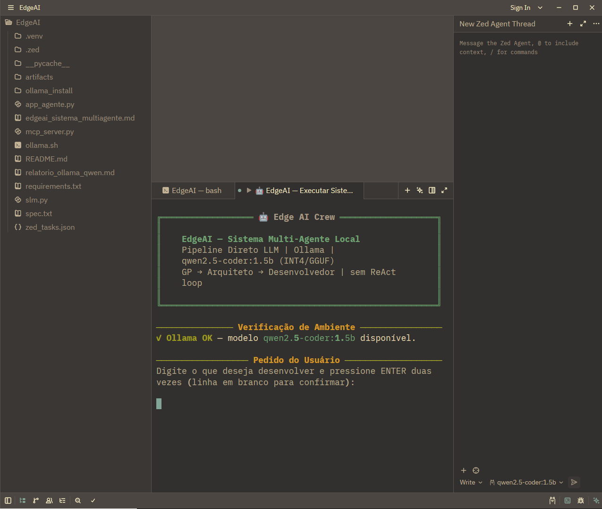
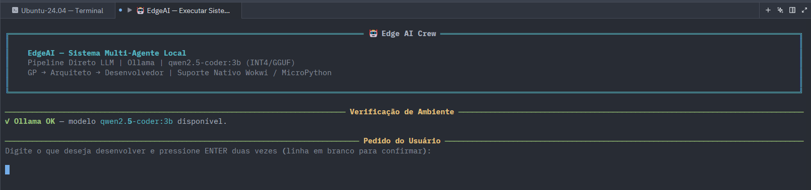
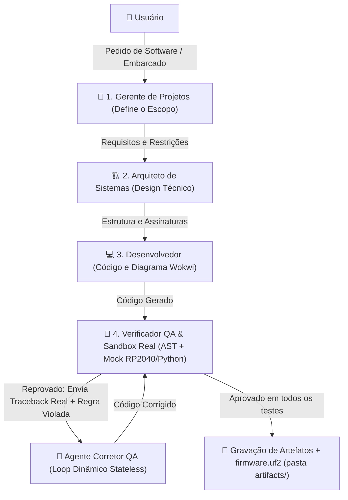

# 🤖 EdgeAI — Sistema Multi-Agente Local
### Projeto desenvolvido para o curso: **I2A2 - Agentic AI: uma introdução**

   


> **Pipeline multi-agente linear sequencial e servidor MCP otimizados para execução local em hardware Edge AI (Restrito/Low-End).**

---

## 📋 Índice
1. [Sobre o Projeto](#-sobre-o-projeto)
2. [Arquitetura do Sistema](#%EF%B8%8F-arquitetura-do-sistema)
3. [Histórico Arquitetural: Do Loop Dinâmico ao Upgrade 1.5B → 3B](#-hist%C3%B3rico-arquitetural-do-loop-din%C3%A2mico-ao-upgrade-15b--3b)
4. [Hardware Alvo e Defesas Contra Bloat](#-hardware-alvo-e-defesas-contra-bloat)
5. [Estrutura do Projeto](#-estrutura-do-projeto)
6. [Instalação e Configuração](#-instala%C3%A7%C3%A3o-e-configura%C3%A7%C3%A3o)
7. [Principais Comandos do Ollama](#-principais-comandos-do-ollama)
8. [Como Executar](#-como-executar)
9. [Como Executar os Artefatos no Simulador Wokwi](#-como-executar-os-artefatos-no-simulador-wokwi)
10. [Integração com a IDE Zed](#-integra%C3%A7%C3%A3o-com-a-ide-zed)
11. [Matriz de Compatibilidade](#-matriz-de-compatibilidade)

---

## ℹ️ Sobre o Projeto

Projeto desenvolvido para o curso **I2A2 - Agentic AI: uma introdução**.

O **EdgeAI** é uma solução de engenharia de software projetada para rodar **sistemas multi-agentes de inteligência artificial de forma 100% local e offline**. Desenvolvido com foco no ecossistema local do **Ollama** e no modelo **Qwen2.5-Coder-7B** (`qwen2.5-coder:7b`) com suporte retrocompatível ao `3b`, o projeto simula uma tripulação de engenharia de software (Gerente de Projetos, Arquiteto e Desenvolvedor) para gerar soluções de código documentadas, testadas e projetos completos de sistemas embarcados para o simulador **Wokwi (Raspberry Pi Pico / MicroPython)** sem precisar de chaves de API pagas ou conexões de rede externas.

Adicionalmente, o projeto inclui um servidor **MCP (Model Context Protocol)** para integração direta como uma ferramenta (tool) na interface de chat do agente da IDE **Zed**.

### Versão com o LLM de Alta Precisão (`qwen2.5-coder:7b`)



## Assista ao vídeo:
[](https://www.youtube.com/watch?v=1Rb6H7dSKRw)  


---

## 🏗️ Arquitetura do Sistema

O fluxo de trabalho combina um pipeline sequencial enxuto com um **Loop Dinâmico de Verificação QA e Auto-Correção Stateless** (até 3 tentativas). Cada etapa recebe apenas o contexto purificado necessário, mantendo a janela de contexto abaixo de 4096 tokens e prevenindo estouro de VRAM na GPU de 2GB.



### Personas dos Agentes e Verificador QA

| Agente / Etapa                 | Função no Pipeline                                                  | Diretriz / Validação Executada                                                                         |
| :----------------------------- | :------------------------------------------------------------------ | :----------------------------------------------------------------------------------------------------- |
| **🎯 Gerente de Projetos (GP)** | Analisa o pedido do usuário e define os limites do projeto.         | Documento conciso: mapa de hardware exclusivo do pedido, requisitos funcionais, não-funcionais e SDK.  |
| **🏗️ Arquiteto de Sistemas**    | Cria o design técnico a partir do escopo do GP.                     | Imports obrigatórios, assinaturas de funções, regras exatas de negócio e escalonamento não-bloqueante. |
| **💻 Desenvolvedor**            | Implementa o código completo (`main.py`/`sketch.ino`/`codigo.py`).  | Código limpo PEP-8, sem dependências externas proibidas, acompanhado do `diagram.json` oficial Wokwi.  |
| **🧪 Verificador QA & Sandbox** | Executa testes reais sobre o código e o circuito antes de aprovar.  | Valida AST/Escopo (`NameError`/`SyntaxError`), roda o código em Sandbox MicroPython/Python (incluindo injeção de falha `OSError`), confere pinos `main.py ↔ diagram.json` e aciona o **Agente Corretor QA** em loop dinâmico se houver falha. |

---

## 🔄 Histórico Arquitetural: Do Loop Dinâmico ao Upgrade 1.5B → 3B

### Fase 1: O Pivô do Loop Dinâmico (CrewAI → Pipeline Sequencial Direto)
Originalmente, o projeto foi planejado utilizando o framework **CrewAI** com um processo hierárquico (`Process.hierarchical`) e loops dinâmicos de correção automática (se um teste inline falhasse, o GP enviaria o erro de volta ao Arquiteto/Desenvolvedor para retificar).

Durante os testes práticos no hardware restrito, foram identificados **três problemas críticos** ao usar modelos de pequeno porte (SLMs):
1. **Falha Sistemática no Protocolo ReAct**: Modelos de até 3B parâmetros não conseguem seguir de forma consistente a lógica *Thought → Action → Observation* exigida pelo motor de agentes do CrewAI, resultando em erros de parser JSON ou loops intermináveis de execução (travados por até 27 minutos).
2. **Context Bloat (Inchaço de Contexto)**: O vai-e-vem dos loops dinâmicos acumulava o histórico no buffer do modelo, estourando rapidamente o limite físico de **4096 tokens**.
3. **VRAM Spillover**: O estouro do contexto forçava o transbordo da memória da GPU de 2GB para a memória RAM (CPU), paralisando o sistema.

**Solução da Fase 1:**
A orquestração complexa do CrewAI foi substituída por um **pipeline sequencial direto via LangChain (`llm.invoke()`)**. Ao invés de manter um chat contínuo volumoso, o pipeline extrai e envia apenas o output final útil de cada etapa.

### Fase 2: Evolução do Modelo (`qwen2.5-coder:1.5b` → `qwen2.5-coder:3b`) e Adequação para o Wokwi
Ao submeter especificações complexas de sistemas embarcados IoT para a plataforma **Wokwi (Raspberry Pi Pico / MicroPython)** (ex.: execução registrada em `artifacts/run_20261122_120216`), o modelo inicial `qwen2.5-coder:1.5b` (986 MB) apresentou limitações severas de domínio:
1. **Alucinação de Bibliotecas Incompatíveis**: O modelo `1.5b` misturava bibliotecas de Linux embarcado/CPython (`import Adafruit_DHT`, `import Adafruit_ADS1x15`, `import Adafruit_SSD1306`), CircuitPython (`board`, `digitalio`, `analogio`) e módulos fictícios (`from wokwi_gpio import Pin, PWMOut`), que **não existem no firmware MicroPython do Raspberry Pi Pico no Wokwi**.
2. **Quebra do Schema Oficial do `diagram.json`**: Em vez de gerar a estrutura exigida pelo simulador Wokwi (`"version": 1`, `"parts": [...]`, `"connections": [...]`), o modelo `1.5b` gerava um JSON meramente descritivo (`{"components": [...]}`), que o Wokwi não consegue renderizar.
3. **Conflito de Prompts Genéricos**: Os prompts originais de `app_agente.py` continham instruções fixas para algoritmos Python de console (`"Python puro, stdlib apenas"`, `"Máximo 150 palavras"`), suprimindo detalhes críticos de pinagem GPIO, ADC de 16 bits (`0..65535`), PWM e interrupções (IRQ).

**Solução Implementada na Fase 2:**
*   **Upgrade para o modelo imediatamente superior (`qwen2.5-coder:3b`)**: Com ~1.9 GB (quantização `Q4_K_M`), o modelo de 3 bilhões de parâmetros cabe no orçamento de memória do hardware alvo (2 GB VRAM + offload híbrido em RAM) e apresenta fidelidade significativamente superior a restrições de API e estruturação de código. A versão `1.5b` foi desinstalada para liberar armazenamento local.
*   **Detecção Dinâmica Multi-MCU e Multi-Linguagem (`detectar_perfil_projeto`)**: O `app_agente.py` identifica automaticamente a placa alvo (`Raspberry Pi Pico / Pico W`, `ESP32 / ESP32-S3 / ESP32-C3`, `Arduino Uno / Mega / Nano`, `STM32 Nucleo`) e a linguagem/SDK solicitada (`MicroPython`, `C/C++ Arduino (.ino)`, `C/C++ SDK Nativo (.c)`, `CircuitPython` ou `Python/C/C++ Desktop`).
*   **Isolamento Estrito de Escopo e `diagram.json` Dinâmico (`construir_diagram_dinamico`)**: Os prompts e o gerador de circuito proíbem terminantemente adicionar periféricos não solicitados pelo usuário (eliminando qualquer circuito estático de fallback) e geram os artefatos específicos de cada stack (`main.py` + `ssd1306.py` + `firmware.uf2` para MicroPython, ou `sketch.ino` + `libraries.txt` para C/C++ Arduino/ESP32).

### Fase 3: Blindagem Determinística Multi-MCU, Isolamento de Hardware e Resolução de Alucinações de SDK
Durante a validação de novos requisitos para o Raspberry Pi Pico (RP2040) em modo multi-agente, foram identificadas vulnerabilidades causadas por contaminação de contexto e alucinações de parâmetros:
1. **Contaminação de Contexto na Seleção de Hardware**: Quando o Gerente de Projetos gerava um escopo citando termos genéricos (ex.: *"Linguagem: MicroPython nativo para RP2040/ESP32"*), a função de detecção de perfil concatenava o pedido com o escopo e chaveava erroneamente para a família ESP32, devido à ausência de prioridade estrita para o RP2040 antes do ESP32. Isso causava conflito entre o gerador de diagramas (que montava pinagem de ESP32) e o código (que seguia os pinos de RP2040), levando a reprovação imediata no QA por pinos ausentes e erro `ENODEV` (I2C não encontrado) no Wokwi.
2. **Alucinação de Assinatura em Drivers Gráficos (`font=font_6x8`)**: O modelo SLM local (3B) frequentemente inseria parâmetros inexistentes na função `display.text()` do MicroPython (`framebuf`), disparando `NameError` durante o parsing de AST e no sandbox.

**Solução Implementada na Fase 3:**
*   **Soberania Estrita do Pedido (`pedido_usuario`)**: A análise de perfil agora prioriza exclusivamente o texto bruto do usuário (`pedido_usuario if pedido_usuario.strip() else escopo`), impedindo que o texto gerado pela IA nas fases intermediárias desvie a plataforma alvo.
*   **Hierarquia Explícita de Hardware**: As variantes do RP2040 (`pico w`, `pi pico`, `raspberry pi pico`, `rp2040`, `wokwi-pi-pico`) possuem prioridade máxima de validação antes de qualquer família ESP32, garantindo mapeamento correto e determinístico de circuitos e barramentos.
*   **Sanitização Determinística Pós-Gerador (`sanitizar_codigo_micropython`)**: O pipeline de pós-processamento agora remove automaticamente argumentos inválidos de fonte (`font=...`), injeta imports ausentes via AST, normaliza chamadas `dht` e infere barramentos I2C0/I2C1 de forma determinística, permitindo 100% de aprovação na bateria de testes de QA e execução limpa no Wokwi.

### Fase 4: Upgrade para `qwen2.5-coder:7b` e Histórico das Limitações Empíricas do Modelo 3B
Apesar das mitigações determinísticas da Fase 3, testes empíricos sucessivos com o modelo `qwen2.5-coder:3b` sob especificações complexas de sistemas embarcados evidenciaram o teto cognitivo de modelos na faixa de 3 bilhões de parâmetros:
1. **Omissão e Regressão de Imports Nativos**: O modelo 3B frequentemente usava `machine.Pin` sem incluir `import machine` no topo, disparando `NameError` em tempo de execução no Sandbox.
2. **Alucinação Cruzada de Dialetos (CircuitPython vs. MicroPython)**: Sob pressão de regras no prompt, o modelo 3B alucinava repetidamente `import board` e módulos da Adafruit, violando a regra de usar estritamente o SDK nativo do MicroPython.
3. **Reimplementação de Classes Dummy Quebradas**: Ao ler menções de drivers gráficos no requisito, o 3B tentava escrever uma `class SSD1306_I2C` ingênua dentro do próprio `main.py` com métodos inexistentes (`bytearray.fill()`), em vez de usar `from ssd1306 import SSD1306_I2C`.
4. **Incompreensão de Escopo Léxico em Laços com Temporizadores**: Ao implementar o escalonamento não-bloqueante (`ticks_ms()`), o modelo 3B atribuía `temp, hum = read_dht()` exclusivamente dentro de um `if` condicional, sem inicializar `temp = None` antes do `while True:`. Isso causava invariavelmente `UnboundLocalError` na primeira iteração do laço.
5. **Inércia / Regressão no Loop de QA**: Ao receber o Traceback real no loop de auto-correção, o modelo de 3B não conseguia manter a coerência global do código: ao tentar corrigir um erro de escopo, regredia gerando novos erros de importação ou removendo campos obrigatórios do JSON de telemetria serial (`led_color`), esgotando as 3 tentativas do QA.

**A Solução Definitiva com o `qwen2.5-coder:7b`:**
*   **Capacidade Paramétrica Superior**: O modelo `qwen2.5-coder:7b` (~4.7 GB, Q4_K_M) atinge 88.4% no benchmark HumanEval Python e compreende com precisão a semântica de módulos embarcados, escopo léxico e instruções de proibição de bibliotecas.
*   **Compatibilidade de Hardware (RTX 5070 8GB VRAM)**: O modelo de 7B cabe integralmente na VRAM dedicada da GPU (~5.2 GB com janela de contexto de 4096 tokens), executando 100% acelerado por hardware sem recorrer a offload na CPU e alcançando alta taxa de tokens por segundo (~45-60 t/s).
*   **Sanitização Preventiva no Loop de QA**: O `app_agente.py` foi atualizado para sanitizar o código preventivamente a cada iteração do QA, garantindo redundância dupla (inteligência do modelo 7B + filtros determinísticos de segurança).

---

## 💻 Hardware Alvo e Configuração

O sistema opera calibrado para ambientes locais de workstation com GPU dedicada e suporta execução em hardware restrito:

*   **Processador**: CPU x86_64 de 8 a 16 núcleos
*   **Memória RAM**: 16 GB totais (~12 GB disponíveis de uso livre)
*   **GPU Dedicada Principal**: NVIDIA GeForce RTX 5070 (8 GB VRAM dedicada — suporta `qwen2.5-coder:7b` 100% na GPU)
*   **Perfil Mínimo Suportado (Edge Restrito)**: NVIDIA GeForce MX110 (2 GB VRAM com quantização híbrida e fallback para `qwen2.5-coder:3b` / `1.5b`)
*   **Sistema Operacional**: Ubuntu Linux (Nativo ou WSL2)

### Estratégias de Mitigação e Calibração
Para rodar com máxima estabilidade e precisão:

*   **Seleção Automática com Fallback**: O `app_agente.py` busca prioritariamente o modelo `qwen2.5-coder:7b` e realiza fallback transparente para o `3b` caso o modelo maior ainda não esteja presente.
*   **Janela de Contexto Calibrada (`num_ctx=4096`)**: Dimensionada para projetos embarcados completos sem transbordo de memória.
*   **Limite Estrito de Geração (`num_predict=2500`)**: Permite geração completa de `main.py` e `diagram.json` em um único turno sem truncamento.
*   **Temperatura Baixa (`temperature=0.1`)**: Prioriza determinismo, lógica e consistência nas respostas de engenharia.
*   **Controle de Threads (`num_thread=6`)**: Deixa núcleos livres para o sistema operacional permanecer fluido.

---

## 📁 Estrutura do Projeto

```
EdgeAI/
├── app_agente.py             # Script principal: Pipeline multi-agente direto via LLM
├── mcp_server.py             # Servidor MCP para integração com o chat do Zed Agent
├── ollama.sh                 # Wrapper Bash para gerenciar e executar o Ollama localmente
├── requirements.txt          # Declaração das dependências do ecossistema Python
├── zed_tasks.json            # Configuração de Tasks customizadas para a IDE Zed
├── slm.py                    # Script de validação simples de inferência da API REST
├── edgeai_sistema_multiagente.md  # Detalhamento técnico da arquitetura multi-agente
├── relatorio_ollama_qwen.md   # Relatório técnico completo do setup local
├── artifacts/                # Diretório onde os artefatos das runs são salvos
│   ├── run_[timestamp]/      # Histórico individual de cada execução
│   │   ├── escopo.md
│   │   ├── arquitetura.md
│   │   ├── codigo.py
│   │   ├── main.py           # (Modo Wokwi) Código MicroPython principal
│   │   ├── diagram.json      # (Modo Wokwi) Circuito no schema oficial do Wokwi
│   │   ├── ssd1306.py        # (Modo Wokwi) Driver MicroPython para display OLED
│   │   ├── wokwi.toml        # (Modo Wokwi) Configuração para extensão Wokwi VS Code
│   │   └── raciocinio.md
│   ├── escopo.md             # Cópia do último escopo gerado (latest)
│   ├── arquitetura.md        # Cópia da última arquitetura gerada (latest)
│   ├── codigo.py             # Cópia do último código gerado (latest)
│   ├── main.py               # (Modo Wokwi) Último main.py gerado (latest)
│   ├── diagram.json          # (Modo Wokwi) Último diagram.json gerado (latest)
│   ├── ssd1306.py            # (Modo Wokwi) Driver OLED SSD1306 (latest)
│   └── raciocinio.md         # Cadeia de raciocínio completa consolidada (latest)
└── ollama_install/           # Diretório local do Ollama offline (binário, libs e modelos)
```

---

## 🔧 Instalação e Configuração

### 1. Preparar o Ambiente Python
Recomenda-se criar um ambiente virtual (venv) para isolar as dependências:

```bash
# Criar e ativar o ambiente virtual
python3 -m venv .venv
source .venv/bin/activate

# Instalar as dependências do projeto
pip install -r requirements.txt
```

### 2. Configurar o Ollama Localmente
Se você deseja utilizar a instalação manual offline provida na pasta do projeto:

```bash
# Tornar o script gerenciador executável
chmod +x ollama.sh

# Iniciar o servidor Ollama local em background
./ollama.sh serve

# Fazer o download do modelo Qwen2.5-Coder-3B
./ollama.sh pull qwen2.5-coder:3b

# (Opcional) Remover versão anterior 1.5B caso esteja instalada
./ollama.sh rm qwen2.5-coder:1.5b
```

> [!NOTE]
> Se preferir instalar o Ollama globalmente no sistema com privilégios administrativos (`sudo`), execute:
> `curl -fsSL https://ollama.com/install.sh | sudo sh`

---

## 🦙 Principais Comandos do Ollama

Você pode gerenciar os modelos tanto pelo script wrapper do projeto (`./ollama.sh`) quanto diretamente pela CLI nativa do Ollama (`ollama` ou `./ollama_install/bin/ollama`).

### 1. Comandos via Wrapper do Projeto (`./ollama.sh`)
O script `ollama.sh` já configura automaticamente variáveis de ambiente locais (`OLLAMA_MODELS`, `OLLAMA_HOST` e `LD_LIBRARY_PATH`):

| Comando | Descrição |
| :--- | :--- |
| `./ollama.sh serve` | Inicia o servidor Ollama local em background (`127.0.0.1:11434`). |
| `./ollama.sh status` | Verifica se o servidor Ollama está online ou offline. |
| `./ollama.sh stop` | Encerra o processo do servidor Ollama em execução. |
| `./ollama.sh pull [modelo]` | Baixa um modelo (padrão: `qwen2.5-coder:3b`). |
| `./ollama.sh rm [modelo]` | Remove um modelo do armazenamento local (ex.: `./ollama.sh rm qwen2.5-coder:1.5b`). |
| `./ollama.sh list` | Lista todos os modelos baixados localmente. |
| `./ollama.sh ps` | Mostra os modelos atualmente carregados na memória. |
| `./ollama.sh run "prompt"` | Executa uma consulta direta ao modelo `qwen2.5-coder:3b`. |
| `./ollama.sh chat` | Abre uma sessão de chat interativo no terminal com o modelo. |
| `./ollama.sh logs` | Exibe as últimas 50 linhas do log do servidor (`ollama_server.log`). |

### 2. Comandos Nativos da CLI do Ollama (`ollama`)
Caso utilize o binário diretamente no terminal:

| Comando | Exemplo de Uso | Descrição |
| :--- | :--- | :--- |
| `ollama serve` | `ollama serve` | Inicia o servidor da API do Ollama. |
| `ollama pull` | `ollama pull qwen2.5-coder:3b` | Baixa ou atualiza um modelo do registro oficial. |
| `ollama run` | `ollama run qwen2.5-coder:3b` | Inicia e executa um modelo (baixa automaticamente se não existir). |
| `ollama stop` | `ollama stop qwen2.5-coder:3b` | Descarrega um modelo em execução da memória (VRAM/RAM). |
| `ollama list` (`ls`) | `ollama list` | Lista todos os modelos armazenados no disco local. |
| `ollama ps` | `ollama ps` | Mostra os modelos atualmente carregados na memória e o uso de VRAM/CPU. |
| `ollama show` | `ollama show qwen2.5-coder:3b` | Exibe informações detalhadas do modelo (parâmetros, arquitetura, Modelfile). |
| `ollama create` | `ollama create meu-modelo -f Modelfile` | Cria um modelo customizado a partir de um arquivo `Modelfile`. |
| `ollama cp` | `ollama cp qwen2.5-coder:3b backup-qwen` | Duplica um modelo existente com um novo nome. |
| `ollama rm` | `ollama rm qwen2.5-coder:1.5b` | Remove um modelo do armazenamento local para liberar espaço. |
| `ollama --version` | `ollama --version` | Exibe a versão instalada do Ollama. |

### 3. Comandos Internos do Chat Interativo (`ollama run`)
Dentro de uma sessão interativa no terminal:
* `/bye` — Sai do chat interativo.
* `/clear` — Limpa o histórico de contexto da conversa atual.
* `/set parameter num_ctx 4096` — Ajusta parâmetros de inferência em tempo de execução.
* `/?` ou `/help` — Lista todos os atalhos e comandos disponíveis no modo interativo.

---

## 🚀 Como Executar

### Modo Interativo
Inicie o script e insira a descrição da sua aplicação. O prompt aceita múltiplas linhas e será executado quando você pressionar a tecla `Enter` duas vezes (uma linha em branco).

```bash
python3 app_agente.py
```

### Modo Batch (Pipeline de Comando)
Você pode enviar a especificação diretamente via pipe (`stdin`), útil para integrações ou automação:

```bash
echo "Escreva uma calculadora em Python que suporte operações básicas e validação de divisão por zero." | python3 app_agente.py
```

---

## 🛠️ Como Executar os Artefatos no Simulador Wokwi

Quando você solicita um projeto embarcado para **Wokwi / MicroPython / Raspberry Pi Pico**, o pipeline gera automaticamente os arquivos prontos para simulação dentro de `artifacts/` (e em `artifacts/run_[timestamp]/`):

*   `main.py` — Código principal em MicroPython (`machine`, `dht`, `time`, `json`, `ssd1306`).
*   `diagram.json` — Esquema elétrico completo no formato oficial do Wokwi (`version: 1`, `parts`, `connections`).
*   `ssd1306.py` — Driver I2C para o display OLED SSD1306.
*   `wokwi.toml` — Configuração para execução local via extensão Wokwi do VS Code.

### Opção 1: Executar no Wokwi Web (Navegador)
1. Acesse o template oficial de MicroPython para Raspberry Pi Pico:
   👉 [https://wokwi.com/projects/new/micropython-pi-pico](https://wokwi.com/projects/new/micropython-pi-pico)
2. Na aba **`main.py`**, cole o conteúdo de `artifacts/main.py`.
3. Clique no botão **`+`** (ao lado das abas) → **New File...** → crie **`ssd1306.py`** e cole o conteúdo de `artifacts/ssd1306.py`.
4. Na aba **`diagram.json`**, substitua todo o conteúdo pelo arquivo `artifacts/diagram.json`.
5. Clique no botão verde **Start the simulation (Play ▶️)** para interagir com os sensores (DHT22, LDR, potenciômetro, botão GP14, servo e OLED) em tempo real.

### Opção 2: Executar no VS Code (Extensão Wokwi Simulator)
Diferente da versão Web, a extensão **Wokwi Simulator** do VS Code exige um binário `.uf2` local do MicroPython configurado no `wokwi.toml`. O `app_agente.py` já empacota automaticamente o `main.py` e o `ssd1306.py` dentro da partição LittleFS2 (`0x100A0000`) do arquivo **`firmware.uf2`**.

1. Instale a extensão **Wokwi Simulator** (`wokwi.wokwi-vscode`) no VS Code e ative sua licença gratuita (`Wokwi: Request a New License`).
2. Abra o arquivo `artifacts/diagram.json` (ou de qualquer subpasta `artifacts/run_*/diagram.json`).
3. Pressione `F1` / `Ctrl+Shift+P` e selecione **`Wokwi: Start Simulator`**.
4. Caso queira reenviar ou testar alterações no `main.py` com o simulador aberto via porta serial virtual (`rfc2217ServerPort = 4000`), mantenha a aba do simulador visível e execute em outro terminal:
   ```bash
   ./.venv/bin/python3 -m mpremote connect port:rfc2217://localhost:4000 fs cp artifacts/ssd1306.py :ssd1306.py + run artifacts/main.py
   ```

---

## 🔌 Integração com a IDE Zed

### 1. Configurando Tasks Customizadas

#### Ambiente Linux Nativo
Para ter atalhos rápidos de execução e gerência dentro da IDE Zed no Linux, importe as configurações para o diretório da IDE ou para a pasta `.zed/` do projeto:

```bash
mkdir -p ~/.config/zed
cp zed_tasks.json ~/.config/zed/tasks.json
```

#### Ambiente Windows + WSL2 (Zed instalado no Windows)
Quando o Zed está instalado no Windows e o projeto roda dentro do WSL2 (`Ubuntu-24.04`), o arquivo `tasks.json` no Windows fica localizado em:
* **Caminho no Windows:** `%APPDATA%\Zed\tasks.json` (ex.: `C:\Users\<SEU_USUARIO>\AppData\Roaming\Zed\tasks.json`)
* **Caminho acessível via WSL2:** `/mnt/c/Users/<SEU_USUARIO>/AppData/Roaming/Zed/tasks.json`
* **Alternativa pela própria IDE Zed:** Pressione `Ctrl+Shift+P` e selecione `zed: open tasks`.
* **Por projeto:** Também fica disponível automaticamente em `.zed/tasks.json` na raiz deste repositório.

> [!NOTE]
> No setup Windows + WSL2, os comandos das tasks utilizam `wsl.exe -d Ubuntu-24.04 --cd /home/vsvasconcelos/projetos/EdgeAI ...` para que o Zed do Windows dispare a execução diretamente dentro do ambiente Linux do WSL2 sem conflito de caminhos.

Abra a IDE Zed no projeto, aperte `Ctrl+Shift+P` (ou `Cmd+Shift+P` no macOS), busque por `Task: Spawn` e escolha uma das opções disponíveis:
*   `🤖 EdgeAI — Executar Sistema Multi-Agente`
*   `🔍 EdgeAI — Verificar Ambiente`
*   `📦 EdgeAI — Instalar Dependências`
*   `🚀 EdgeAI — Iniciar Ollama`
*   `⬇️ EdgeAI — Baixar Modelo`
*   `⚡ EdgeAI — Executar em Modo Batch`

### 2. Configurando o Servidor MCP (Model Context Protocol)
O arquivo `mcp_server.py` permite que o agente interno do Zed (IA integrada) utilize a sua tripulação local de agentes como uma ferramenta.

Para registrar o servidor MCP no seu Zed:
1. Abra as configurações globais do Zed (`Ctrl+,` ou `zed: open settings` — no Windows fica em `%APPDATA%\Zed\settings.json`).
2. Adicione ou edite o bloco `context_servers` em seu `settings.json`:

**No Linux nativo:**
```json
{
  "context_servers": {
    "edgeai-agents": {
      "command": "/home/vsvasconcelos/projetos/EdgeAI/.venv/bin/python3",
      "args": ["/home/vsvasconcelos/projetos/EdgeAI/mcp_server.py"],
      "env": {
        "PYTHONUNBUFFERED": "1"
      }
    }
  }
}
```

**No Windows com WSL2 (`Ubuntu-24.04`):**
```json
{
  "context_servers": {
    "edgeai-agents": {
      "command": "wsl.exe",
      "args": [
        "-d",
        "Ubuntu-24.04",
        "--cd",
        "/home/vsvasconcelos/projetos/EdgeAI",
        "env",
        "PYTHONUNBUFFERED=1",
        "PYTHONIOENCODING=utf-8",
        "/home/vsvasconcelos/projetos/EdgeAI/.venv/bin/python3",
        "/home/vsvasconcelos/projetos/EdgeAI/mcp_server.py"
      ]
    }
  }
}
```

3. Certifique-se de que a dependência `fastmcp` ou `mcp` está instalada no seu Python global ou venv em execução.
4. Agora, no chat do Zed Agent, você poderá invocar a ferramenta `rodar_pipeline_agentes` enviando um pedido de funcionalidade!

---

## 📊 Matriz de Compatibilidade

As versões abaixo foram homologadas e garantem o funcionamento correto do ecossistema:

| Tecnologia        | Versão             | Observação                                              |
| :---------------- | :----------------- | :------------------------------------------------------ |
| **Python**        | 3.14.4 / 3.x       | Linguagem de execução padrão do pipeline                |
| **Ollama**        | v0.30.11 / v0.31.1 | Motor de inferência local rodando na porta 11434        |
| **Qwen2.5-Coder** | 3B (INT4 / Q4_K_M) | Modelo de linguagem local principal (~1.9 GB) — substituiu a versão 1.5B |
| **CrewAI**        | v0.11.2            | Legado de arquitetura (não utilizado no pipeline ativo) |
| **LangChain**     | Versão resolvida   | Biblioteca base de interação com ChatOllama             |
| **FastMCP**       | 0.x                | SDK para encapsulamento das ferramentas MCP             |

---

> [!TIP]
> Todos os códigos Python gerados pelo desenvolvedor local são salvos automaticamente em formato bruto no arquivo `artifacts/codigo.py`, pronto para execução e testes imediatos.
